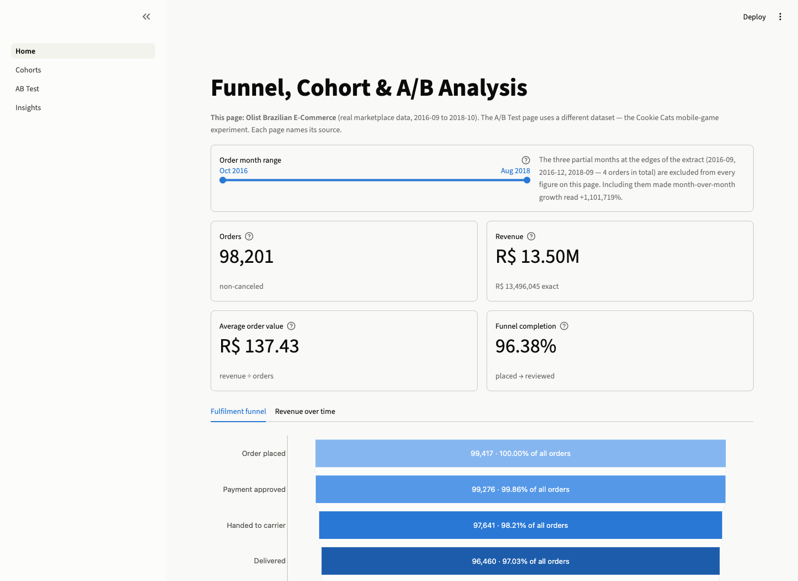
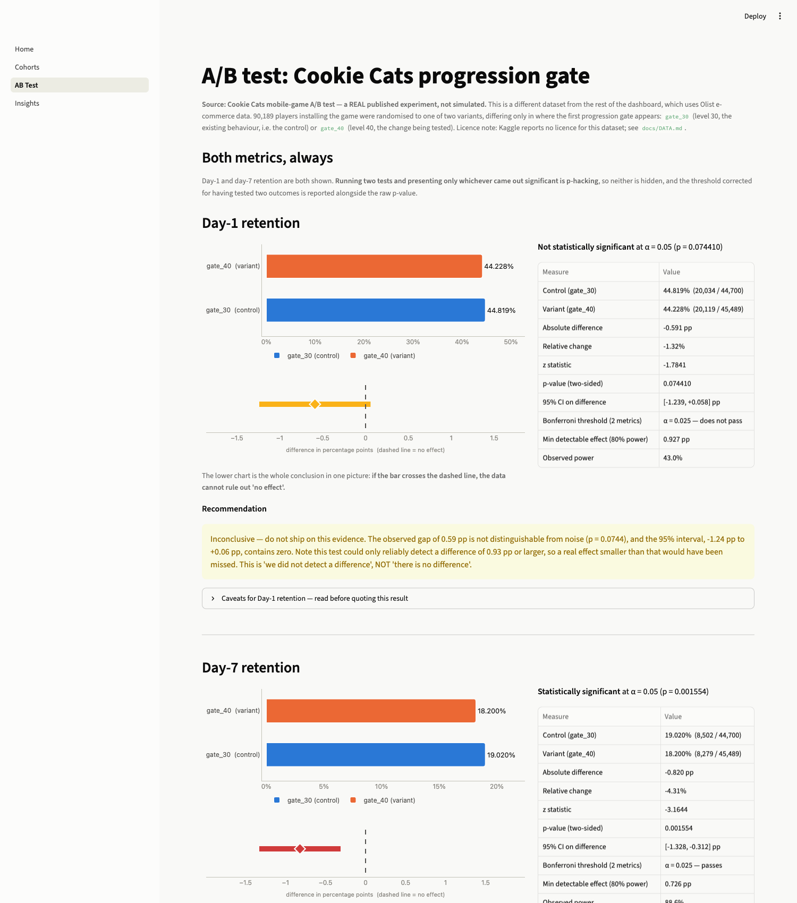

# Funnel, Cohort & A/B Analysis

An analytics stack built on PostgreSQL: two public datasets loaded into a warehouse, modelled
with SQL views, and shown in a Streamlit dashboard. 14.5 million rows, 12 views, 108 tests.



## What it answers

The dashboard has four pages covering three questions.

**Where do orders drop out of fulfilment?** The biggest single loss is 1,637 orders (1.65%)
between payment approval and handover to the carrier. Payment approval itself only loses 0.16%,
so the obvious place to look is the wrong one. End to end, 96.35% of placed orders complete the
journey.

**Do customers come back?** 2,997 of 96,096 customers ever place a second order, which is 3.12%.
Month-1 retention for cohorts of 1,000 or more runs between 0.11% and 0.72%. Total revenue is
R$ 13,496,408 across 98,205 orders, average order value R$ 137.43.

**Does advertising actually cause conversions?** From a randomised test where 15% of users were
withheld from targeting at random:

| | Control (withheld) | Treatment (targeted) |
|---|---|---|
| Users | 2,096,937 | 11,882,655 |
| Site visit | 3.8201% | 4.8543% |
| Conversion | 0.1938% | 0.3089% |

Conversion lift is +0.1152 percentage points, 95% CI [+0.1085, +0.1219], which is +59.45% in
relative terms. The effect is real, and it is small: roughly one extra conversion per 870
targeted users. Whether that pays depends on margin against cost per impression, which this
data does not contain.

The split is on the random assignment, not on whether a user was actually shown an ad. Exposure
is downstream of treatment, so splitting on it would compare self-selected groups and would not
be causal.



## Running it

Needs Docker, Python 3.11 and a Kaggle API token.

```bash
cp .env.example .env            # set a password for each CHANGE_ME
                                # openssl rand -base64 24

python3 -m venv .venv && ./.venv/bin/pip install -r requirements.txt

mkdir -p data/raw/olist data/raw/criteo
kaggle datasets download -d olistbr/brazilian-ecommerce -p data/raw/olist --unzip
curl -L -o data/raw/criteo/criteo-research-uplift-v2.1.csv.gz \
  "https://huggingface.co/datasets/criteo/criteo-uplift/resolve/main/criteo-research-uplift-v2.1.csv.gz"

make db-up db-init              # Postgres 16, schemas, roles, tables, indexes
make load                       # 14,527,185 rows, about 50 seconds
make views
make test
make app                        # http://localhost:8501
```

Also available: `make export` writes the views out as CSVs for a BI tool, plus `make lint`,
`make security`, `make psql` and `make db-down`.

Every `make` target runs through `./.venv/bin`, so it uses the pinned dependencies rather than
whatever happens to be on PATH.

## How it is put together

```
CSVs → src/load/ → PostgreSQL (schema raw) → 12 views (schema analytics) ──┬→ Streamlit
                     contracts + COPY          CTEs, window functions      ├→ src/analysis/
                                                                           └→ exports/*.csv
```

The metric definitions live in SQL, not Python. The dashboard, the CSV exports and this README
all read the same views, so a number has one definition and they cannot disagree. Python only
does the statistical test, which Postgres cannot.

The dashboard connects as `dashboard_ro`, a role with SELECT on `analytics` and no privileges at
all on `raw`. A view runs with its owner's privileges, so the views read `raw` on its behalf
while the app cannot touch `raw` directly. There are tests for both halves of that.

## The data

| | Olist Brazilian E-Commerce | Criteo Uplift v2.1 |
|---|---|---|
| Used for | funnel, cohorts, revenue | the experiment |
| Size | 99,441 orders, 2016-09 to 2018-10 | 13,979,592 users |
| Licence | CC BY-NC-SA 4.0 | CC BY-NC-SA 4.0 |

Attribution, which both licences require:

- *Brazilian E-Commerce Public Dataset by Olist*, published by Olist, licensed under
  [CC BY-NC-SA 4.0](https://creativecommons.org/licenses/by-nc-sa/4.0/).
- *Criteo Uplift Prediction Dataset v2.1*, published by Criteo AI Lab, licensed under
  [CC BY-NC-SA 4.0](https://creativecommons.org/licenses/by-nc-sa/4.0/).

Neither permits commercial use. This project is non-commercial and the data is not
redistributed here — the commands above download it from the original sources.

One thing worth stating plainly: this is a fulfilment funnel, not a marketing one. Olist
publishes no clickstream data, so "visit → signup → cart → purchase" is not derivable from it.
The five stages are real order-lifecycle timestamps and their NULLs are the drop-off.

## Tests

108 tests, run by `make test` and in CI alongside ruff, bandit, pip-audit and gitleaks.

Most of them assert properties rather than values, so they survive a data refresh: the funnel is
monotonically non-increasing, retention never exceeds 100%, the cohorts partition the customer
base, running totals never decrease, category shares sum to 100% within a month. The statistics
module is checked against statsmodels to 1e-10 plus two hand-worked examples.

One test re-derives every published figure from the database and fails if any of them
stops matching, which is what keeps the documentation honest.

The source data is not in the repo — 425 MB and licence-restricted — so in CI the data-dependent
tests skip and the schema, the views and the pure logic are what get checked.

## Layout

```
app/        Streamlit: Home, Cohorts, AB Test, Insights
sql/ddl/    schemas, roles, tables, indexes
sql/views/  12 views, each with a COMMENT ON VIEW
src/        config, db, load, analysis, export
tests/
```

Every view carries a `COMMENT ON VIEW` saying which business question it answers, so
`\dv+ analytics.*` in psql is a reasonable table of contents.
