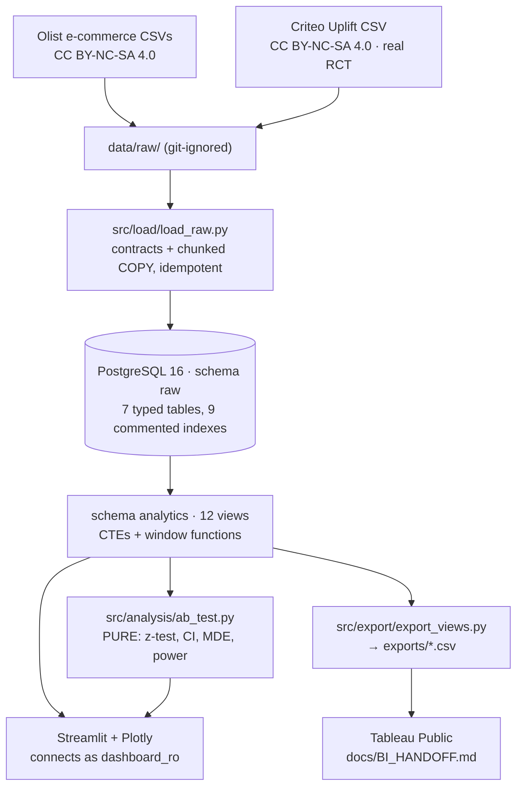

# Funnel, Cohort & A/B Analysis Dashboard

PostgreSQL + SQL + Python + Streamlit. Two real public datasets, twelve documented SQL views,
a statistically honest A/B readout, and a four-page dashboard.

**Every number below was produced by a query or script in this repo and is re-checked by a
test.** `tests/test_documented_numbers.py` re-derives all 56 published figures from the
database and fails if any of them stops matching.


---

## What it answers

| Question | Where | Dataset |
|---|---|---|
| Where do orders drop out of the fulfilment pipeline? | Home → Fulfilment funnel | Olist |
| Do customers come back, and for how long? | Cohorts | Olist |
| Is revenue growth accelerating? | Home → Revenue over time | Olist |
| Does advertising actually *cause* conversions? | A/B Test | Criteo |
| So what should we actually do? | Insights | both |

---

## Measured results

### The funnel leaks in logistics, not in payments

| # | Stage | Orders | Lost here | Step conversion |
|---|---|---|---|---|
| 1 | Order placed | 99,441 | — | — |
| 2 | Payment approved | 99,281 | 160 | 99.84% |
| 3 | Handed to carrier | 97,644 | **1,637** | **98.35%** |
| 4 | Delivered | 96,461 | 1,183 | 98.79% |
| 5 | Delivered & reviewed | 95,815 | 646 | 99.33% |

The biggest single loss is **payment approved → handed to carrier: 1,637 orders (1.65%)** —
roughly **10×** the payment-approval failure rate of 0.16%. End to end, **96.35%** of placed
orders complete the journey. *(`analytics.v_funnel_dropoff`)*

### It is a single-purchase marketplace

**2,997 of 96,096 customers (3.12%)** ever placed a second order. Month-1 retention for
cohorts of 1,000+ customers runs **0.11%–0.72%**. Total merchandise revenue
**R$ 13,496,408.43** across **98,205** orders, **AOV R$ 137.43**.
*(`analytics.v_cohort_retention`, `v_repeat_purchase_summary`, `v_revenue_by_month`)*

### Advertising does cause conversions — and the effect is small

A randomised **incrementality test**: 15% of users were **withheld** from ad targeting at
random, which makes the comparison causal rather than correlational.

| | Site visit | Conversion |
|---|---|---|
| Control — randomly withheld (2,096,937 users) | 3.8201% | 0.1938% |
| Treatment — targeted (11,882,655 users) | 4.8543% | 0.3089% |
| Absolute lift | **+1.0342 pp** | **+0.1152 pp** |
| Relative change | +27.07% | **+59.45%** |
| p-value | **< 1e-300** | **7.3e-179** |
| 95% CI on the lift | [+1.0056, +1.0629] pp | **[+0.1085, +0.1219] pp** |
| Min detectable effect (80% power) | 0.0410 pp | **0.0096 pp** |

**The honest reading is two-sided.** The effect is unambiguously **real** — across 14 million
users the interval is tight and nowhere near zero, and both outcomes clear the
Bonferroni-corrected threshold for having tested two. But it is **small**: about one extra
conversion per 870 targeted users. Whether that pays depends on margin per conversion against
cost per impression, which this dataset does not contain. The next step is a break-even
calculation, not "advertising works, spend more".

**The methodological point.** The data also records whether each user was actually *shown* an
ad. Splitting on that is the tempting mistake: being shown an ad is a *consequence* of the
treatment, and users who get shown ads are systematically more active, so that comparison is
self-selected and not causal. This is an **intention-to-treat** analysis — it splits on the
random assignment — and a test asserts it stays that way.

*(`python -m src.analysis.ab_report`)*


---

## Architecture



**Business logic lives in SQL, not Python.** The dashboard, the CSV exports and this README all
read the same `analytics` views, so a metric has exactly one definition and they cannot
disagree. Python does only what SQL cannot: the statistical test.

**The dashboard connects as `dashboard_ro`** — `SELECT` on `analytics`, and *no privileges at
all* on `raw`. A view runs with its owner's privileges, so it reads `raw` on the caller's
behalf while the app cannot touch `raw` directly. This is asserted by tests, and it caught a
real mistake during development (see `ai-context/DECISIONS.md` D-018).

---

## Run it

Needs Docker, Python 3.11 and a Kaggle API token (`~/.kaggle/kaggle.json`).

```bash
git clone <this repo> && cd funnel-cohort-ab-dashboard
cp .env.example .env            # then set a password for each CHANGE_ME
                                # generate with: openssl rand -base64 24

python3 -m venv .venv && ./.venv/bin/pip install -r requirements.txt

# Download the data (42 MB + 311 MB) -- see docs/DATA.md for licences
mkdir -p data/raw/olist data/raw/criteo
kaggle datasets download -d olistbr/brazilian-ecommerce       -p data/raw/olist        --unzip
curl -L -o data/raw/criteo/criteo-research-uplift-v2.1.csv.gz \
  "https://huggingface.co/datasets/criteo/criteo-uplift/resolve/main/criteo-research-uplift-v2.1.csv.gz"

make db-up db-init              # PostgreSQL 16 + schemas + roles + tables + indexes
make load                       # 14,527,185 rows in 52s
make views                      # 12 analytics views
make test                       # 108 tests
make app                        # http://localhost:8501
```

Other commands: `make export` (CSVs for Tableau), `make lint`, `make security`,
`make psql`, `make db-down`.

---

## The data

| | Olist Brazilian E-Commerce | Criteo Uplift v2.1 |
|---|---|---|
| Used for | funnel, cohorts, revenue | the experiment |
| Licence | **CC BY-NC-SA 4.0** | **CC BY-NC-SA 4.0** |
| Size | 99,441 orders, 2016-09 to 2018-10 | 13,979,592 randomised users |

Credit to **Olist** and to **Criteo AI Lab** for publishing these datasets. Both require
attribution and neither permits commercial use.

> **Why the experiment dataset was swapped.** An earlier version used the Cookie Cats
> mobile-game A/B test, for which Kaggle reports **no licence at all**. It was replaced with
> the Criteo data specifically so the project has a *verifiable* licence chain rather than one
> dataset described as "unknown" — both licences were checked directly, on Criteo's own page
> and in the official Hugging Face repository's metadata. (`ai-context/DECISIONS.md` D-023.)

> **Two measured corrections to the publisher's own description.** Criteo's page says the
> dataset has "25M rows"; the v2.1 file actually has **13,979,592**. And Criteo's own download
> link is **dead** — the storage host no longer resolves — so `docs/DATA.md` gives the Hugging
> Face URL instead. D-009 applies to a third party's claim about its own data too.

**This is a fulfilment funnel, not an acquisition funnel.** Olist publishes no clickstream
data, so "visit → signup → cart → purchase" is not derivable from it and inventing those stages
would be fabricating results. The five stages are real order-lifecycle timestamps (D-006).

---

## Things this project got wrong, and fixed

Kept because the fixes are the interesting part. Full write-ups in `ai-context/DECISIONS.md`.

| What | Why it mattered |
|---|---|
| **The funnel reported a negative drop-off** | Stages were defined independently, so "has a review" counted 98,673 against 96,476 delivered. Olist sends its review survey at *order* time, so 2,843 undelivered orders had reviews. Stages are now cumulative. (D-013) |
| **Month-over-month growth read +1,101,719%** | 2016-12 contains a single R$10.90 order. Sparse edge months are now flagged and excluded from growth maths — flagged, not deleted, so totals still reconcile. (D-014) |
| **`pip-audit` found 56 CVEs in a fully pinned file** | Pinning guarantees reproducibility, not safety — the pins were stale. The worst offender, `pillow`, was never in `requirements.txt`; it arrived via `streamlit`. CI now audits the full transitive lock file. (D-012) |
| **The dashboard crashed with "permission denied for schema raw"** | A query reached into `raw` from the app. The fix was a new view, not a wider grant — the error was business logic in the wrong layer. (D-018) |
| **A CSV formula-injection guard that did nothing** | It tested `dtype == object`, correct on pandas 2.x. On pandas 3.x text columns are `str`, so the guard silently no-op'd. A security guard with no test is a guard you only think you have. (`tests/test_export.py`) |
| **Numbers truncated to "R$ 13…" at a 1280px window** | Built and screenshotted at 1500px. A truncated number is a wrong number. Layouts are now checked at 1100/1280/1440. (D-019) |
| **A p-value printed as 0.000000** | With z = 65 the true value is ~1e-926, below float64's floor, so Python returns exactly `0.0`. Printing "p = 0" states something mathematically false — a p-value is always positive. It now prints the bound `< 1e-300`. |
| **A dataset with an unverifiable licence** | The original A/B data had no licence on Kaggle. Swapped for one whose CC BY-NC-SA 4.0 licence was checked at source — and whose publisher's own row count and download link both turned out to be wrong. (D-023) |

---

## Security

Full requirements in `docs/SRS.md` (SEC-1 … SEC-13), with a threat model mapped to the OWASP
Top 10. In short:

- **Two database roles.** `loader_rw` writes to `raw`; `dashboard_ro` has `SELECT` on
  `analytics` only and no rights on `raw`. Asserted by tests.
- **Parameterised SQL only.** `fetch_df` refuses a plain `str` and requires a
  `sqlalchemy.text()` object — the type system does the enforcing.
- **No secrets in git.** `.gitignore` was written *before* `git init`. CI runs gitleaks over
  the full history.
- **No personal data.** Free-text review columns and the geolocation table are never loaded;
  exports are aggregates only, with an identifier guard that fails the export rather than
  publishing one.
- **CI gates:** `ruff`, `bandit`, `pip-audit` (on the transitive lock file), `gitleaks`,
  `pytest`. A milestone is not done until all five pass.

---

## Repo map

```
ai-context/   ARCHITECTURE.md · DECISIONS.md (24 entries) · PROGRESS.md
docs/         SRS.md · TECH_SPECS.md · DATA.md · QUERIES.md · BI_HANDOFF.md
sql/ddl/      schemas, least-privilege roles, typed tables, commented indexes
sql/views/    12 views, each with a COMMENT ON VIEW stating its business question
src/          config · db · load · analysis · export
app/          Streamlit: Home, Cohorts, A/B Test, Insights
tests/        108 tests
```

Start with `docs/QUERIES.md` — it has every view's business question, its measured output, and
the bug each one caught.
